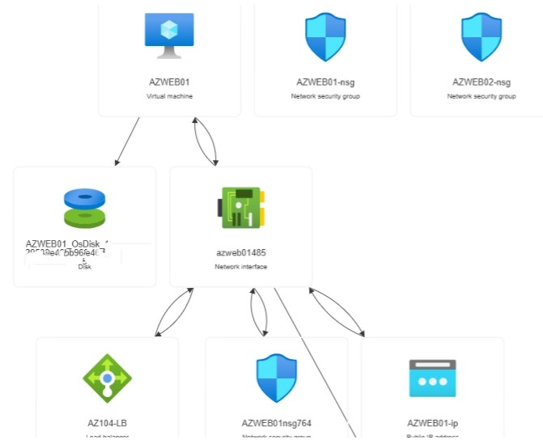
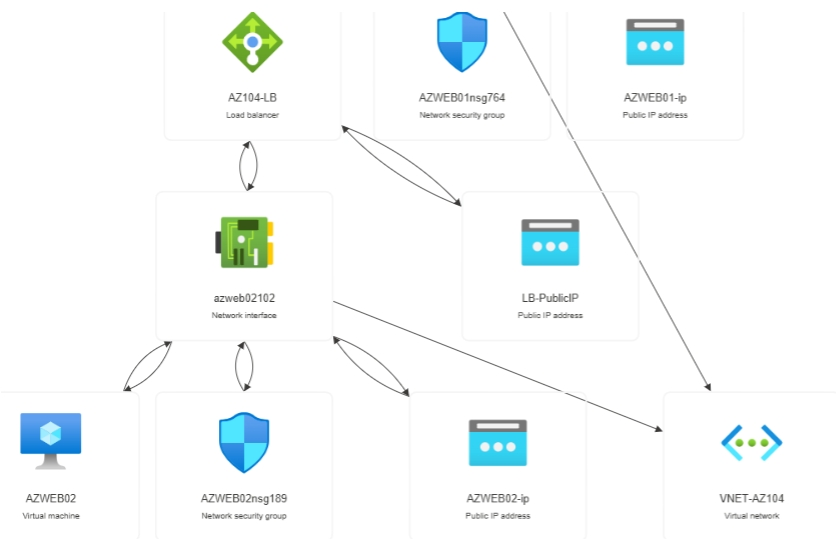

# Azure Infrastructure Project

## Overview

This project demonstrates the deployment and configuration of Azure infrastructure components including networking, virtual machines, load balancing, managed identity, RBAC, and Azure Key Vault.

## Technologies Used

- Azure Virtual Machines
- Azure Virtual Network
- Azure Load Balancer
- Azure Key Vault
- Managed Identity
- RBAC
- IIS

## Project Components

- Resource Group
- Virtual Network
- Subnets
- Two Windows Virtual Machines
- Azure Load Balancer
- Azure Key Vault
- Secret Management

## Skills Demonstrated

- Azure Administration
- Azure Networking
- Identity and Access Management
- Cloud Security
- Technical Documentation

## Lessons Learned

- Configured Azure networking resources
- Deployed and managed Azure virtual machines
- Implemented load balancing across multiple servers
- Troubleshot RBAC permission issues
- Created and managed secrets in Azure Key Vault

## Architecture Diagram

### Azure Resource Visualizer

